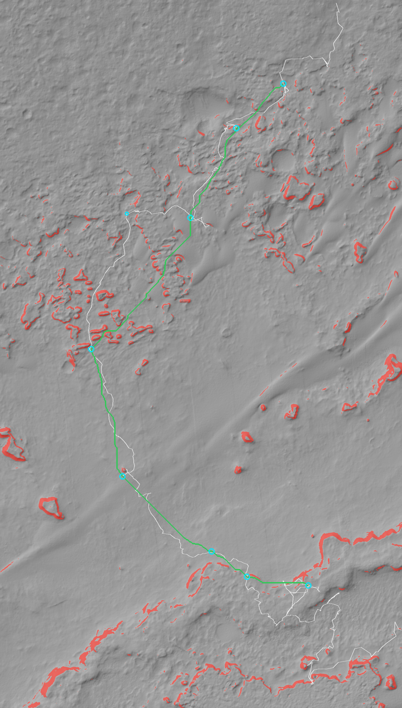
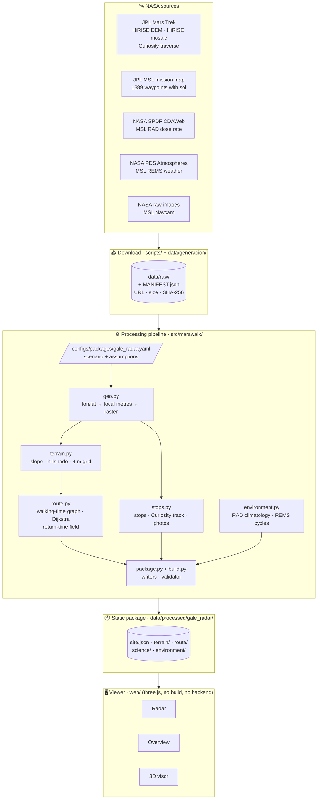
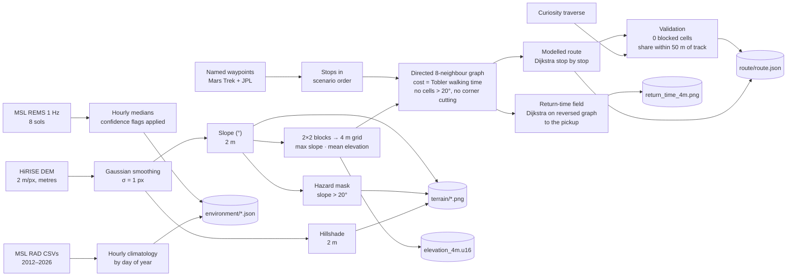
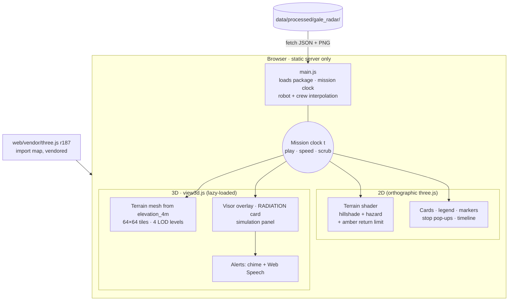
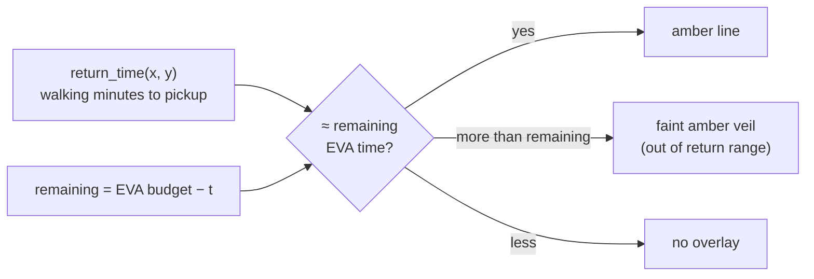
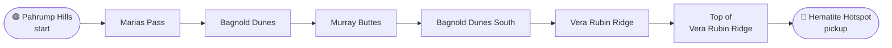

# Marswalk Radar — NASA Space Apps Challenge 2026

**Challenge:** [Interplanetary Survival Guide: Martian Map](https://www.spaceappschallenge.org/2026/challenges/interplanetary-survival-guide-martian-map/)

**▶ Live demo:** <https://nazarenofolica.github.io/marswalk-radar/web/>

A **tactical tablet for astronauts on a Marswalk** at Gale Crater, built entirely from NASA mission data. An
astronaut-centred, heading-up radar answers the three questions a crew asks during an EVA:

| Question | What the radar shows |
|---|---|
| **Where can I walk?** | Terrain relief, slopes above 20° in red, the modelled route and Curiosity's historical track as reference |
| **How much time do I have?** | EVA clock, remaining time, return margin and an amber **return limit**: how far the crew can go and still reach the pickup rover in time |
| **What is next?** | Science stops with distance by route, ETA, elevation change and the real Navcam photo Curiosity took there |

The EVA is **simulated**: a scout robot and the crew move along the modelled route on a playable mission clock.
Every environmental value is a **historical observation** (MSL RAD, MSL REMS), never live data.

<p align="center">
  
  <br>
  <sub>Study area (2.9 × 5.2 km): relief, slopes &gt; 20° (red), modelled route (green), Curiosity's track (white), stops (cyan).</sub>
</p>

---

## Contents

- [Quick start](#quick-start)
- [The viewer](#the-viewer)
- [Architecture](#architecture)
- [Tech stack](#tech-stack)
- [Default scenario](#default-scenario)
- [Method](#method)
- [NASA data used](#nasa-data-used)
- [Repository layout](#repository-layout)
- [Limitations](#limitations)
- [Use of AI](#use-of-ai)

---

## Quick start

Try it online at <https://nazarenofolica.github.io/marswalk-radar/web/>, or run it locally:

```bash
pip install -r requirements.txt
python -m http.server 8000          # from the repo ROOT, then open http://localhost:8000/web/
```

The processed data package (`data/processed/gale_radar/`, 13 MB) is committed, so the viewer runs right away with
no build step, no backend and no external requests.

Rebuild the package only after changing the scenario in [`configs/packages/gale_radar.yaml`](configs/packages/gale_radar.yaml):

```bash
python data/generacion/generar_todo.py                             # once: heavy raw data (photos, RAD, REMS), ~10–15 min
python scripts/build_package.py configs/packages/gale_radar.yaml   # data/raw -> data/processed/gale_radar (~15 s)
python -m pytest -q                                                 # 9 tests
```

Useful demo links (URL parameters are listed in [`web/README.md`](web/README.md#url-parameters-demo-and-testing)):

- `http://localhost:8000/web/?t=262&play=0&view=overview`: whole route, with the amber return limit in view
- `http://localhost:8000/web/?view=3d`: first-person view through the helmet visor

## The viewer

Three views share one mission clock (play / pause, ×10 to ×300, timeline scrubber):

| View | What it is |
|---|---|
| **Radar** | Main screen. Crew at the centre, heading up, range 250 m / 500 m / 1 km. Red hazard cells, green route, dotted Curiosity track, stop markers, edge arrows to off-screen stops and the amber return limit |
| **Overview** | Whole area, north up. Same layers; good for briefing and debriefing |
| **3D** | First person through a helmet visor over the HiRISE terrain. Adds a RADIATION card and a simulation panel |

- **TERRAIN card:** slope under the crew, steepest slope in the next 200 m, elevation.
- **WINDOW card:** elapsed time, remaining time, **return margin** (remaining time minus walking time back to the pickup).
- **RADIATION card (3D):** historical average, minimum and maximum dose rate measured by Curiosity RAD for this day
  of the year and time of day (2012–2026).
- **Simulation panel (3D):** set oxygen, CO₂, suit pressure, atmospheric pressure, radiation and time of day by hand.
  Crossing a limit shows a red chip and plays a chime plus a spoken alert (Web Speech API, on-device voice only).
- **Stop pop-up:** distance by route, ETA, Δz and the Navcam photos of that stop (credit NASA/JPL-Caltech).
- **Assumptions & sources panel (`i`):** every number is labelled *measured*, *derived* or *assumed*.

---

## Architecture

The project has two halves joined by a **static data package**: an offline Python pipeline that turns NASA data
into small, pre-computed layers, and a browser viewer that only reads those files.

### End-to-end flow



### Processing pipeline in detail



### Viewer at runtime



How the **amber return limit** is drawn: for every 4 m cell the pipeline stores the walking time to the pickup
(`return_time_4m.png`). Each frame the terrain shader compares that time with the EVA time left and paints the
cells where they match. That is why the limit follows the terrain instead of being a circle.



---

## Tech stack

| Layer | Technology | Why |
|---|---|---|
| Data download | Python, `requests` | Scripted, reproducible pulls; every file recorded with source URL and SHA-256 in `MANIFEST.json` |
| Raster I/O | `tifffile`, `Pillow` | Read Float32 GeoTIFF DEMs, write 8-bit PNG and raw uint16 layers |
| Terrain & routing | `numpy`, `scipy` (`ndimage`, `sparse.csgraph.dijkstra`) | Slope, smoothing, and shortest paths on a ~960k-node graph in seconds |
| Environment data | `pandas` | RAD multi-year CSVs and 1 Hz REMS tables summarised into hourly statistics |
| Configuration | YAML (`pyyaml`) | Scenario and assumptions in one editable file, shown in the UI |
| Tests | `pytest` | Coordinates, route rules (no blocked cells, no corner cutting) and package contract |
| Viewer | Vanilla JS (ES modules), HTML, CSS | No framework, no build step, no npm |
| Rendering | **three.js r187** (vendored in `web/vendor/`) | Orthographic 2D radar with custom GLSL shaders, and a 3D LOD terrain mesh |
| Audio alerts | Web Audio API + Web Speech API | Chime and spoken alert, on-device only |
| Hosting | Any static server (`python -m http.server`, GitHub Pages) | The viewer makes no external requests |

---

## Default scenario

All values are assumptions, editable in [`configs/packages/gale_radar.yaml`](configs/packages/gale_radar.yaml).

Two astronauts walk from **Pahrump Hills** to **Hematite Hotspot** (Vera Rubin Ridge), where a pressurized rover
picks them up. They stop at 6 science sites for 20 minutes each, within a 6 h EVA budget starting at 10:00 LMST.
A scout robot (1 km/h) drives the route 90 min ahead of them.



| Result (modelled route) | Value |
|---|---|
| Distance | **5.34 km** (3.69 km straight line; Curiosity drove 9.3 km between the same points) |
| Time | 2 h 43 min walking + 2 h at stops = **4 h 43 min** of a 6 h budget |
| Minimum return margin | 77 min |
| Climb | +346 m / −31 m |
| Steepest slope | 19.1° (limit 20°); 75 % of the distance below 10° |
| Validation | 0 blocked cells, 0 corner cuts; 57 % within 50 m of Curiosity's track (mean distance 80 m) |

---

## Method

- **Coordinates:** spherical Mars (r = 3389.5 km), local frame in metres (x East, y North, origin at the SW corner).
- **Slope:** 2D gradient of the HiRISE DEM at 2 m/px after Gaussian smoothing (σ = 1 px), because DEM noise
  inflates slopes at that scale. Cells above 20° are hazards.
- **Route:** 4 m grid (2×2 blocks keep the *maximum* slope, so a hazard is never averaged away), directed
  8-neighbour graph, 20° hard limit, no corner cutting. Edge cost is walking time from a Tobler hiking curve
  scaled to 2.5 km/h on flat ground: faster slightly downhill, slower uphill. Shortest path stop by stop
  (Dijkstra). If two stops are not connected the engine says so and never relaxes the limit.
- **Return limit:** walking time from every cell to the pickup (Dijkstra on the reversed graph).
- **Radiation (MSL RAD):** absorbed dose rate in tissue-equivalent plastic (µGy/day). Hourly climatology by day of
  year over all years; reference = median of the last 30 days (185.6 µGy/day). No conversion to mSv; human
  exposure is not modelled.
- **Weather (MSL REMS):** hourly medians of 8 sols spread over one Mars year, with confidence flags applied. Used
  for the measured pressure range and the EVA time-of-day window.

---

## NASA data used

| Data | Mission / instrument | Source |
|---|---|---|
| Digital terrain model, 1 m (used at 2 m) | MRO HiRISE | JPL Mars Trek |
| Orbital image mosaic | MRO HiRISE | JPL Mars Trek |
| Rover traverse and named waypoints | MSL Curiosity | JPL Mars Trek; JPL MSL mission map |
| Surface radiation dose rate (2012–2026) | MSL RAD | NASA SPDF / CDAWeb (`MSL_RAD_OBS-L2`) |
| Surface weather (8 sols) | MSL REMS | NASA PDS Atmospheres Node |
| Point-of-view images | MSL Navcam | NASA raw images |

Every downloaded file is listed with its exact URL, size and SHA-256 in [`data/raw/MANIFEST.json`](data/raw/MANIFEST.json).
Dataset details: [`data/README.md`](data/README.md).

Image credits: NASA/JPL-Caltech (Navcam), NASA/JPL/University of Arizona (HiRISE).

---

## Repository layout

```
├── configs/
│   ├── packages/gale_radar.yaml   Scenario and assumptions of the package
│   └── sites/gale.yaml            Study-area boxes used by the download scripts
├── scripts/                       Download scripts + build_package.py
├── data/
│   ├── raw/                       NASA data + MANIFEST.json (photos, RAD, REMS regenerated by data/generacion/)
│   ├── generacion/                Generators for the heavy raw data
│   └── processed/gale_radar/      Static package read by the viewer
├── src/marswalk/                  Processing pipeline (geo, terrain, route, stops, environment, package, build)
├── tests/                         pytest
└── web/                           three.js viewer; data contract in web/README.md
    └── vendor/                    three.js r187 (MIT)
```

More detail: [`src/marswalk/README.md`](src/marswalk/README.md) (pipeline modules) and
[`web/README.md`](web/README.md) (package contract, coordinates, encodings, URL parameters).

---

## Limitations

- The walking-speed curve is an exploratory assumption for suited astronauts, not a validated model.
- The 20° slope limit only covers steepness; loose sand, rocks below 4 m and dust are not modelled.
- Curiosity's track is a reference from a rover, not proof that a human can walk there.
- RAD timestamps are UTC, not Mars local time, so matching by hour of day is a simplification.
- Conditions in the simulation panel (oxygen, CO₂, suit pressure, etc.) are set by hand to show the alerts; they
  are not sensor data.

## Use of AI

Claude (Anthropic) was used as a coding and research assistant: data discovery, download scripts, the processing
pipeline and documentation drafts. Claude Fable was used to generate the first version of the three.js interface.
All AI-assisted work was reviewed by the team and is declared in the submission.
